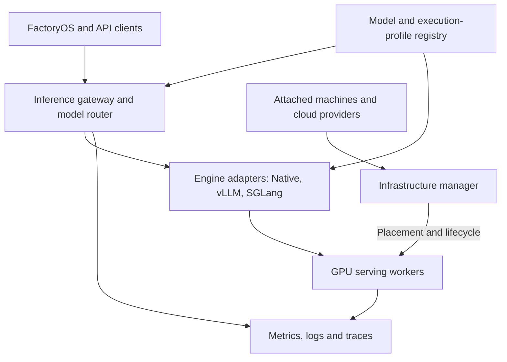
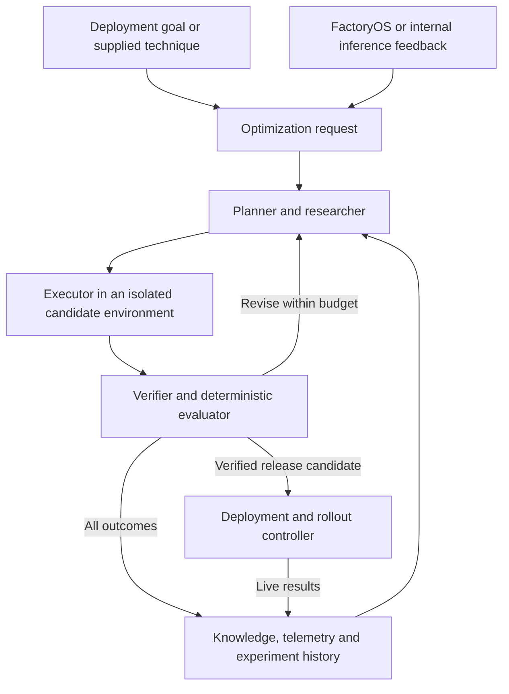

# InferStack: inference improvement harness and deployment platform

Status: target architecture, agreed from the user's November 7, 2026 clarification.
Product intent clarified 9 November 2026: the integrated research, implementation,
experiment, diagnosis and deployment feedback loop is the product center. See
[INFERENCE_HARNESS_PLAN.md](INFERENCE_HARNESS_PLAN.md) for the current product plan
and next integration priorities. Historical audit baselines below remain dated evidence.
Runtime audit baseline: `33f897e39f484447036867e7c7e4c296e1b50806`.
The imported v1.6.0 Qwen runtime is the starting implementation. Components below
are planned unless the [repository audit](CURRENT_STATE_AUDIT.md) establishes otherwise.

## Product goal and ownership

InferStack owns an inference improvement harness. FactoryOS feedback and external
research enter the same evidence-backed planning and execution workflow; experiment
and production outcomes drive diagnosis and bounded replanning. Deployment is part
of that loop. Engine runtimes are pluggable execution backends. The harness itself
can improve through independently evaluated, versioned changes without letting a
candidate alter its own authoritative evaluator or acceptance rules.

Serve supported model deployments at the best measured capacity available from
their engines, hardware and cloud infrastructure, subject to latency, quality,
availability, memory and cost objectives. Continuously improve inference through
a planner, executor and verifier owned by InferStack.

Capacity means useful work delivered within objectives. GPU utilization is a
diagnostic, not the objective by itself. Operational SLOs encode the measurable
goals; an SLA may additionally define contractual commitments.

| Project | Owns | Interface to InferStack |
| --- | --- | --- |
| FactoryOS | Agent tasks, tools, workflows and harness improvement | Inference requests and inference-specific feedback/problems/plans |
| Model Foundry | Training, adaptation, source model weights and model lifecycle | Immutable artifacts, tokenizer/config revisions and model issues |
| InferStack | Model serving, engine selection, execution optimization, infrastructure integration, inference harness and rollout | Responses, deployment endpoints, capacity, measurements and optimization outcomes |

InferStack can create versioned serving representations through packing,
quantization or compilation. It preserves the original artifact. Quantization
requires an explicit quality budget; it does not imply numerically identical output.

## Three optimization entry points, one workflow

1. **Deployment goal:** "Optimize this hosted deployment for these SLOs." Inspect
   deployment identity, current measurements, workload and implementation.
2. **Supplied technique:** ingest text or an accessible URL from a paper, GitHub,
   X, LinkedIn or a human. Research the underlying method and its applicability.
   Image/document extraction can follow the same source contract later.
3. **Feedback:** FactoryOS, an operator or InferStack telemetry identifies an
   inference problem. Correlate request/trace IDs and diagnose the relevant scope.

A supplied method is a claim to investigate. A supplied plan is a candidate plan.
Both enter the same evidence and verification process as internally generated plans.
Restricted or unavailable sources are recorded as unavailable; user-supplied text
is a sufficient starting input. Continuous external monitoring is a later service
capability, not a dependency for manual technique submission.

## System structure

### Serving and infrastructure

InferStack's native engine owns its internal scheduler, cache and kernel dispatch.
Third-party engines retain their own internal scheduling/cache semantics.
The common gateway routes requests and applies deployment-level admission policy;
it does not attempt to run a second token scheduler over vLLM or SGLang.

Workers use separate processes or containers per deployment/engine environment.
This also prevents native module-global kernel patches and counters from leaking
between hosted models or experiment variants.

Infrastructure responsibilities include GPU and CPU inventory, driver/runtime
compatibility, device placement, network/storage characteristics, resource leases,
replicas, cost/budget limits, health, teardown and provider lifecycle. Begin by
attaching an existing machine; add cloud provisioning through adapters.

Colab is an attached experiment worker with an ephemeral lifetime. A durable
cloud serving deployment requires a suitable host and deployment lifecycle.
The optimizer model and target experiments need separate resource allocations
or serialized GPU leases, so optimization cannot distort its own benchmark.

### Optimization harness

**Planner/researcher:** use tools to retrieve deployment state, logs, metrics,
profiles, relevant code, previous attempts and external sources. Produce a
structured, evidence-linked hypothesis and executable experiment DAG. Support
the user's DeepSeek/OpenRouter options first; provide interchangeable adapters
for other hosted or local optimizer models. Normalize structured results and
tool capabilities rather than assuming every provider implements the same API.

**Executor:** apply configuration changes, install a pinned compatible plugin,
or implement code/kernel changes in a candidate branch/worktree and isolated
runtime. Build the artifact, run tests and collect all outputs. Third-party
engine modifications must use a supported extension, configured backend or
versioned fork; a generic adapter cannot inject arbitrary kernels into every engine.

**Verifier:** a model may critique the hypothesis and explain results. Eligibility
for release comes from versioned deterministic correctness, quality, performance,
SLO and regression gates. Candidate code cannot rewrite the authoritative evaluator
or its held-out workload and thereby validate itself.

The workflow persists state, step attempts, leases, heartbeats, timeouts and
idempotency keys. A crash resumes or safely retires an attempt. GPU/process cleanup
runs on success, failure, timeout and cancellation. Bounded iterations, time,
provider-token and GPU-hour budgets prevent an endless loop.

## Four separate extension contracts

| Extension | Scope | Example |
| --- | --- | --- |
| Engine adapter | Model compatibility, launch/attach, readiness, request/stream forwarding, cancellation, metrics, stop | Native / vLLM / SGLang / remote API |
| Technique/backend plugin | A compatible runtime transform or implementation | Cache policy, attention backend, GDN kernel, quantization implementation |
| Optimizer provider | Structured planning and optional tool reasoning | DeepSeek, OpenRouter, OpenAI, Anthropic, local model |
| Infrastructure provider | Inventory, allocation, deploy, inspect, scale, release and cost | Existing GPU machine, cloud VM, later Kubernetes/Ray integration |

Each extension declares its supported engine/runtime versions, model operations,
dtype, shapes, hardware and required dependencies. A remote API engine may
provide client-side metrics while offering no access to kernels, GPU telemetry
or internal profiling. Such limits are explicit capabilities.

## Persistent knowledge and operational evidence

Start with a relational metadata store: SQLite for one local worker and PostgreSQL
for a shared hosted control plane. Use schema migrations and test both modes
before claiming equivalent behavior. Store large artifacts outside relational rows.

| Record | Required content |
| --- | --- |
| ModelArtifact | Model/config/tokenizer revisions, source identity, task and artifact checksums |
| HardwareEnvironment | GPU identity, memory, topology, CPU/RAM, driver, CUDA, libraries, region/provider |
| Deployment | Engine/image revision, plugins, profile, placement, endpoint, resources and active release |
| WorkloadSpec and Objective | Prompt/output distributions, arrivals, concurrency, cache conditions, SLOs, quality/cost limits |
| Evidence and Technique | Source text/URL, retrieval time, content hash, code commit, license/provenance, claims and compatibility |
| OptimizationRequest and Plan | Trigger, deployment target, hypothesis, evidence, action DAG, gates, budgets and stopping rule |
| Experiment and Trial | Baseline/candidate identity, treatment, environment, raw artifacts, metrics, errors and decision |
| Release and Rollout | Immutable artifact/profile references, validation policy, traffic stages, monitoring and rollback target |

Use an artifact store for traces, logs, patches, reports and build outputs:
local paths initially, object storage for distributed operation. Retain checksums
and lineage. Prometheus-compatible metrics provide operational time series;
metadata links to evidence windows instead of inserting every token event into SQL.
Keep raw provider data alongside normalized metrics and record schema/version mapping.

Telemetry must distinguish queueing, tokenization, prefill, decode, cache,
sampling, streaming/network, model startup and infrastructure effects. Aggregate
logs alone cannot identify individual GPU operators; capture targeted profiles.
Record low-overhead production metrics separately from instrumented experiments.
Capture request metadata by default; content capture and retention are configurable.

## Verification and comparison rules

- Count generated tokens from authoritative engine usage/token IDs where available.
  Record retokenized text only as an identified estimate. SSE event count is never
  a general token count. Report client chunk gaps separately from actual token timing.
- Record client-visible first content timing and engine-reported TTFT separately.
  Grouped streaming makes exact per-token latency unavailable at the client.
- Define TPOT, ITL, E2E and throughput units/aggregation explicitly. One-token output
  has no post-first-token TPOT. Missing, NaN or infinite measurements cannot pass.
- Require complete streams, expected request counts, healthy workers and identified
  effective feature/backend use. Configuration flags alone do not establish activation.
- Compare matched model/tokenizer revisions, workload, cache conditions and hardware.
  Record changed dependency/backend/precision as intentional experimental treatments.
- Use repeated baseline/candidate trials with a balanced order, warmup, sample
  adequacy, confidence/uncertainty reporting and CV/MAD noise diagnostics. A few
  requests do not establish a reliable p99.
- Apply numerical gates appropriate to kernels, quality gates appropriate to
  approximate representations, and serving regression gates for cancellation,
  cache isolation, liveness and overload. Output-string similarity alone is not quality.
- Apply hard SLO/quality/resource constraints first, then epsilon-Pareto and
  objective-based ranking. Store keep/reject/retest/inconclusive outcomes with reasons.
  Previously discussed v1.4 judge behavior must be recovered or reimplemented;
  it is not present in the imported v1.6 snapshot.
- Optimize goodput and measured/identified cost as appropriate. Availability and
  longer-duration tail behavior need deployment evidence beyond a microbenchmark.

## New-model onboarding and execution profiles

Inspect the model task and architecture; query supported engine/operation
capabilities; resolve immutable artifact revisions; establish a reference
baseline; construct compatible initial profiles; measure remaining gaps; then
enter the same optimization workflow. Unsupported operations create explicit
adapter work, not an automatic claim of "any model" support.

Profiles are scoped to model artifact, engine/build/plugin set, hardware
environment, workload, quality contract and SLOs. A code optimization produces a
new engine/build artifact as well as a profile. Profile changes alone cannot
deploy a missing implementation.

## Deployment and feedback routing

A release manifest binds model/tokenizer revision, engine/container digest,
plugin revisions, profile, resource placement and verification evidence.
Build candidate releases without changing active workers. Start and warm the new
release, verify readiness and representative traffic, shift traffic in bounded
stages, monitor serving SLOs, and roll back to the previous compatible release
when configured thresholds fail. Preserve in-flight requests through draining.
Code/plugin changes use replacement workers rather than patching a live process.

The user's chosen environment and deployment policy determine which verified
candidates can roll out automatically. Real cloud account, region, available
GPU resources, credentials and spend limits must be configured before allocation;
this architecture document provisions nothing.

FactoryOS sends a versioned InferenceIssue with problem/trace identity, deployment,
observations and desired objectives. InferStack diagnoses and owns the response.
Confirmed model-quality/training issues go to Model Foundry; harness/tool workflow
issues go to FactoryOS. Ambiguous cases preserve evidence and request further
diagnosis rather than forcing a confident classification.

## External integration basis

Primary documentation reviewed November 7, 2026:

- [vLLM production metrics](https://docs.vllm.ai/en/latest/usage/metrics/):
  reuse engine metrics through a version-aware normalizer.
- [SGLang production metrics](https://docs.sglang.io/docs/references/production_metrics)
  and [request tracing](https://docs.sglang.io/docs/references/production_request_trace):
  reuse metrics/tracing while preserving their measurement semantics.
- [vLLM plugins](https://docs.vllm.ai/en/latest/design/plugin_system/) and
  [SGLang backend plugins](https://docs.sglang.io/docs/developer_guide/serve_backend_plugins):
  use supported extensions and pin their compatible engine versions.
- [NVIDIA Container Toolkit architecture](https://docs.nvidia.com/datacenter/cloud-native/container-toolkit/latest/arch-overview.html):
  GPU container execution integration.
- [Ray Serve LLM architecture](https://docs.ray.io/en/latest/serve/llm/architecture/overview.html):
  a possible later deployment/placement adapter. Ray is not a requirement for
  the first functioning optimization loop.

These references establish integration options, not performance claims.
See the [implementation plan](IMPLEMENTATION_PLAN.md) for release-sized work.
