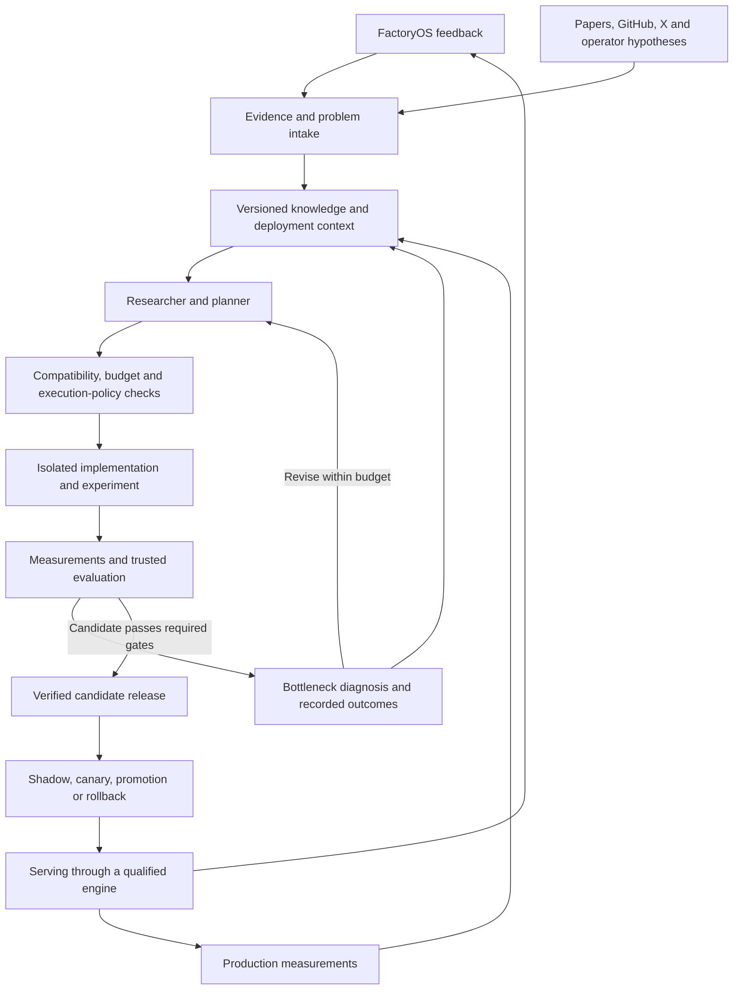

# InferStack: integrated inference improvement harness

Product clarification: 9 November 2026. This plan captures the user's intended product and defines the next integration work. It is a plan, not a claim that the complete loop is qualified.

First operational consumer: FactoryOS applications and agents. InferStack also accepts external research and standalone evaluation workloads. Deliver one integrated candidate; internal work packages are implementation steps, not separate products the user must install.

## 1. Product definition

InferStack is an inference improvement harness with deployment built into its feedback loop. It understands the current inference implementation, studies new techniques, proposes changes, implements isolated experiments, measures outcomes, diagnoses remaining bottlenecks and safely deploys verified improvements. It learns from successful, failed and inconclusive attempts.

The objective is the best demonstrated inference configuration for a particular model, hardware and workload, within latency, quality, reliability, memory and cost limits. There is no promise of finding a global optimum or discovering a breakthrough on every run. A valid result can be that no tested change improves the current deployment.

Native InferStack, vLLM and SGLang are execution backends. Engine selection is part of an optimization campaign, subject to compatibility and evidence. New engines are added when they offer a needed, testable capability. InferStack's native runtime remains a focused research/execution backend for the model families it implements; it does not need to reproduce every other engine's features.

The optimizer model is independent of the serving engine and serving model. Existing provider contracts remain interchangeable. A faster optimizer-provider endpoint and a faster target-serving configuration are different experiments.

## 2. The complete feedback loop

Two main sources supply new work:

1. **FactoryOS feedback:** slow or failed model requests, task outcomes, tool/JSON failures, long-context problems, inference cost and capacity concerns, with deployment and trace identity.
2. **External evidence:** a paper supplied tomorrow, a GitHub change, an engine release, an X post, or an operator's technique/hypothesis.

InferStack's own experiments and production measurements feed back into that same loop. A deployment goal is another way to initiate it.

A new paper enters as a claim to investigate. It does not become an installed dependency or production change merely because the source is popular. Replanning is driven by specific evidence: what changed, what was measured, which constraint failed and what bottleneck remains.

Example: a KV-cache paper suggests reducing memory use. The planner retrieves the actual cache implementation, model/engine/hardware identity, workload and earlier attempts. An isolated candidate implements a supported version of the technique. Measurements show lower memory use but longer decode latency; a targeted profile identifies an expensive conversion kernel. The next hypothesis addresses that kernel, preserving the parent experiment and its failed latency result. The final combined candidate is remeasured against the original baseline and evaluated on held-out tasks before rollout. FactoryOS task outcomes and external datasets both contribute, with distinct measurement scopes.

## 3. What InferStack should own

| Own and improve | Integrate through an explicit contract |
|---|---|
| Evidence intake, provenance, applicability and experiment memory | Papers, public repositories and submitted external material |
| Deployment/workload context retrieval and bottleneck diagnosis | Engine metrics, profiling tools and hardware inventory |
| Hypotheses, bounded experiment campaigns and safe implementation | Native runtime, vLLM, SGLang and qualified plugins/forks |
| Trusted verification, comparison, learned outcomes and release eligibility | Established evaluation datasets and task-specific test fixtures |
| Immutable releases, deployment coordination and recovery obligations | Container/Kubernetes lifecycle, model storage, GAIE-compatible routing and KEDA |
| Inference-harness improvements and their independent qualification | FactoryOS as the first operational consumer and feedback producer |

FactoryOS owns its applications, tools and application-agent harness. Model Foundry owns training/adaptation and source model artifacts. InferStack owns its inference harness and serving representations, including qualified configuration, packing, compilation and kernel changes. Training a new drafter or changing application logic is a request to the appropriate owner; InferStack can evaluate the resulting immutable artifact.

## 4. Current foundation and remaining integration boundary

Source inspection baseline: 5a06e3ef28920ad70fa53f07509872f25838d157. Other agents have uncommitted isolation/test work in progress; preserve it. This planning task does not rerun their qualification or certify their implementation.

The repository now includes evidence ingestion, technique assessment, provider-backed planning, typed action DAGs, isolated configuration/plugin/source execution, durable job/resource ownership, endpoint verification, releases and recovery. Commits also implement the earlier cloud-serving P0–P5 packages: durable live evidence, cache/storage and loader options, release-scoped pools, scaling ownership, shadow traffic, cost attribution and compatibility-manifest tooling. See the dated implementation status in [the cloud plan](CLOUD_SERVING_RESEARCH_PLAN.md).

That is a substantial foundation. The next work should connect, harden and qualify it rather than recreate these modules. Existing CPU/kind checks are not GPU performance evidence. The latest T4 commit adds an FP16 conformance path and instructions; it does not establish that a live T4 or A100 run passed. Hardware results must name the exact artifact and environment.

Concrete integration gaps observed in source:

- There is no bounded coding stage that turns a technique description into a stored code diff. The planner prompts for source_patch description/files, and validation permits it without patch_sha256, but IsolatedExecutor.build_source requires that existing artifact. Executing a supplied patch is implemented; autonomously implementing a new technique is not. Add an explicit implementation handoff rather than treating prose as executable code.
- Executor cleanup still calls a synchronous provider stop from the worker's event loop. Slow cleanup can starve lease renewal and leave a verified attempt without a terminal job result. Fix this recovery boundary before extending campaign duration or implementation scope; see the reproduced source review.
- PlannerTools.list_experiments currently summarizes the supplied history for the current job. Long-lived retrieval of relevant results from other campaigns needs a deliberate query and applicability contract.
- research/techniques.py currently accepts a proven_by trial on matching engine and model names as a compatibility proof. Evidence reuse needs tighter identity, treatment, outcome and workload scope checks.
- Engine capabilities have declared/tested/observed concepts, but several descriptions retain old implementation states. Reconcile them with actual qualification artifacts rather than maintain competing truth tables.
- serving/evidence.py derives an itl_ms value from client content-event span and aggregate token usage. That is a client-derived decode average, not observed engine token-emission timing or an ITL distribution. Preserve that distinction in gates, reports and optimizer inputs.
- Configuration keys accepted by the planner, materialized by the executor and observed by engine adapters must agree. Declaring a loader or speculative feature in one place is not an end-to-end executable technique.
- The worker currently returns after the first keep and uses its configured iteration count, rather than interpreting every declared plan stop_rule. Make first-improvement versus bounded continued refinement an explicit controller-owned campaign policy.
- FactoryOS currently records quality/error feedback for triage rather than automatically treating it as an optimization job. Extend diagnosis deliberately; do not silently claim that this category already executes an improvement loop.

## 5. Context and experiment memory

Give the planner bounded, read-only access to a versioned context snapshot, not an unfiltered database dump. The snapshot should answer:

- What exact code/build, engine, model/tokenizer, precision, plugins and hardware are running?
- Which serving path, deployment resources, route policy and observed features are effective?
- What does the workload look like: input/output lengths, arrivals, concurrency, cache state, tool/JSON/reasoning modes and objectives?
- Which techniques are merely claimed, executable, measured, eligible, deployed, rejected or invalidated?
- What was tried before, on which setup, with what raw evidence, noise, quality result, cost and failure mode?
- What is the present bottleneck, how confidently is it identified, and which observation would distinguish alternative explanations?
- What resources and budget remain, and which changes are outside this campaign's scope?

Keep structured identities, lineage and decisions in the existing relational store. Keep code in pinned source repositories and large traces/profiles/build outputs in the artifact store, referenced by digest. Start with relational filters and bounded artifact/code retrieval; a separate vector database is not a prerequisite.

Use existing record types where they fit, adding versioned fields or records only where required. A campaign needs linked source evidence, context snapshot, hypothesis, implementation/treatment, trials, diagnosis, verdict and release/rollout outcomes. Failed attempts remain searchable. Repeated summaries retain their evidence references and uncertainty; they cannot convert an unsupported claim into a proven fact.

Define an evidence reuse key over model/tokenizer revision, engine/build/plugin versions, precision, hardware/topology, workload/cache regime, technique parameters and evaluator/measurement policy. Some results may transfer only as hypotheses. Proof of a safe old configuration is not proof of a different kernel, GPU, workload or model revision. Deterministic failed gates and a stale or missing evidence artifact cannot establish compatibility_proven.

## 6. Bottleneck-driven planning and execution

The planner should choose the next experiment from a diagnosis, not from the newest headline. Candidate bottlenecks include startup/download, CPU/tokenization, queue/admission, prefill compute, decode memory/compute, KV capacity/reuse, host/device transfer, interconnect, kernel overhead and network/streaming. Quality or task failures may instead come from model, prompt, tool protocol or application behavior; attribute them before changing inference.

Treat a diagnosis as an evidence-backed hypothesis. Low-overhead metrics identify likely causes; bounded profiling discriminates between them. Isolate profiling overhead from performance trials. If telemetry is insufficient, the next action gathers evidence rather than inventing a kernel bottleneck.

Supported experiment classes, in increasing integration cost:

1. Engine configuration and placement on existing supported hardware.
2. Compatible engine alternatives for the same pinned model and workload.
3. Engine-supported techniques: caching, batching, speculation, approved packing/quantization or compiler profiles.
4. Supported extension/plugin or a pinned third-party engine fork.
5. Native runtime/kernel source changes, or a new technique implementation when existing integrations cannot address the measured bottleneck.

Engine alternatives require a comparable baseline per engine and an identical source model/task contract unless a model or representation change is explicitly the treatment. Do not silently substitute a different model while claiming an engine optimization. An unsupported engine/model intersection is not a failed performance result.

Run a small, bounded search first. Use a cheap constraint/compatibility filter, then short diagnostic trials, then repeated full-engine measurements and held-out quality checks. Proxy or microkernel gains only prioritize candidates. The final combined change is compared with the original baseline; interactions between individually useful changes can regress the combined result.

Record keep/reject/retest/inconclusive distinctly. A promising but noisy result asks for more evidence within budget. Hard failures reject; insufficient evidence remains inconclusive. Every new diagnosis links back to the trial that produced it, so the next planner iteration can explain why its hypothesis changed.

### Implementation handoff: an idea must become an immutable candidate

Keep planning, candidate implementation and authoritative verification as separate roles in the existing durable workflow. Add a bounded implementer interface: a human-supplied diff and a coding agent can both satisfy it. An autonomous campaign needs the coding-agent path; accepting a manually prepared patch alone does not complete the intended product.

The implementer receives a pinned source/build snapshot, the scoped hypothesis and evidence, allowed files, tool/resource limits and fixed acceptance requirements. It produces a content-addressed patch/build manifest with touched files, source identity, dependencies, implementation logs and candidate-owned tests. A description-only proposal stays in a needs_implementation state; it must not be marked executable or launched as an experiment. Source candidate creation fails closed if the diff or its identity is missing or invalid.

Validate and test the artifact in an isolated workspace before invoking the existing executor. Trusted evaluators, held-out cases, budget/lease enforcement and release controls remain outside candidate-write authority. Candidate tests supplement independent tests; they cannot replace them. Execution and measurement still use the recorded exact artifact, and generated output cannot grant itself broader scope.

Journal implementation attempts and their provider/compute costs, cancellation, timeout and failure outcomes so recovery does not silently regenerate a different treatment. A changed diff creates a new candidate identity. An unsuccessful build or diagnosis links to the next bounded hypothesis; no unbounded fix-until-pass loop is implied. Native kernel/runtime paths can be supported first. Third-party engine forks and harness-code candidates need separate scoped source/build contracts, not a global relaxation of PATCH_ROOTS.

## 7. Improving the inference harness itself

InferStack should also improve how it researches, diagnoses and experiments. Candidate harness improvements include better retrieval/ranking, richer context snapshots, more useful profiling actions, engine selection, experiment scheduling, failure classification, evidence summaries and deployment recovery. These are part of the product, not a separate application-agent project.

There are two distinct candidate scopes:

- **Serving candidate:** changes engine/profile/plugin/kernel/deployment behavior and is evaluated for inference outcomes.
- **Harness candidate:** changes the planner, diagnosis or experiment workflow and is evaluated against the incumbent harness on frozen inference-optimization tasks and resource budgets.

The candidate harness must not rewrite its own authoritative evaluator, held-out tasks, budget enforcement or acceptance rules. Those are governed separately from candidate-controlled code. Changing the evaluation policy creates a new policy version and requires independent regression validation; old results stay bound to the old policy.

Measure harness changes by verified improvements found per fixed GPU-hour/provider-token/spend budget, correctness of diagnoses, repeated failed treatments avoided, experiment turnaround, recovery reliability and final deployment outcomes. Do not reward more hypotheses, more generated code, more tool calls or a favorable model-written explanation by themselves.

Borrow faster experimentation ideas from [Together Compiler](https://www.together.ai/blog/together-compiler-continual-compilation-for-ai-inference) and [JITEngine](https://github.com/skydiscover-ai/jitengine) as research directions, not qualified features. Begin with immutable weight/build caches and explicit setup reuse. Persistent experimental workers come later and must demonstrate clean state reset, exclusive resources and fresh final verification. Production workers never become candidate sandboxes.

## 8. Deployment is part of the same experiment, with separate gates

A candidate that passes laboratory verification becomes release-eligible; it is not automatically deployed. An operator-configured policy determines whether a verified release may progress automatically or awaits an explicit rollout request. No new external-account or spending authority is implied by an incoming paper or feedback event.

Bind release identity, verification policy, selected engine/profile, artifacts, resource limits and rollback target. Use bounded shadow traffic, then a canary when permitted. Observe model/API health, tail latency, stalls, quality/task indicators, cost and actual replica identity. Keep a usable rollback target and recover after controller/worker crashes.

FactoryOS should test real tasks against the candidate and stable endpoint without mutating InferStack resources directly. Task feedback must include model/release/deployment and trace identity, test version, observed outcome and measurement window. Offline datasets measure controlled quality; FactoryOS task completion measures application usefulness. Neither alone proves all deployment properties.

Successful release results and post-rollout regressions both update experiment memory. Workload drift can schedule a new bounded campaign after sufficient evidence, deduplication and cooldown. Adaptation follows explicit triggers and budgets; it is not an endless optimizer loop.

Routing and scaling remain infrastructure contracts. InferStack chooses an immutable release; the configured router selects compatible workers within that release; one scaling actuator owns replicas. Cache-aware routing is enabled only for engine profiles with qualified signals. Deployment support and optimization support can differ for a managed external API.

## 9. Next work packages

The cloud plan's P0–P5 remains the serving infrastructure and qualification foundation. The packages below connect it into the intended inference harness. They are not declarations that an existing feature is missing merely because it appears here: extend existing code and verify the complete path.

| Package | Build or refine | Acceptance |
|---|---|---|
| H0: reconcile truth and qualification | Current implementation ledger, engine capability evidence, measurement provenance, narrowly scoped proof reuse, aligned profile schemas and nonblocking lease-safe cleanup | Failed trials cannot prove a technique; a different revision/GPU/dtype/workload does not become proven automatically; grouped stream events cannot manufacture zero engine ITL; accepted profile patches are materializable; slow cleanup preserves renewal and terminal state; GPU checks are evidenced or explicitly unsupported |
| H1: deployment context and cross-campaign memory | Versioned context snapshot; bounded retrieval of code, past trials, profiles and outcomes | A fresh job retrieves relevant prior failures/successes with exact references, excludes inaccessible/unrelated data and reports missing context |
| H2: unified evidence intake and diagnosis | Paper/GitHub/X submissions and FactoryOS issues enter one typed problem/research workflow; add targeted profile/diagnosis results | Submitted external text cannot change tool authority; insufficient evidence requests measurement; quality/error intake classifies ownership before proposing a treatment |
| H3: bounded implementation and refinement campaigns | Explicit implementer handoff and immutable diff/build artifacts; engine/config/technique candidates; parent-child hypotheses; controller-owned stop policy and verifier-driven replanning | A source idea produces a validated stored patch before execution; implementation resumes without silently changing its artifact; an induced kernel or cache bottleneck produces a traceable next hypothesis; failed treatments are not blindly repeated; budget/cancel/crash cleanup works |
| H4: FactoryOS-to-release integration | Candidate task tests, verification evidence, rollout policy, actual endpoint observations and feedback callbacks | One real FactoryOS issue and one submitted research technique each complete the workflow; rollout failure restores a qualified stable target and records the outcome |
| H5: harness improvement and faster experiments | Incumbent/candidate harness comparison; immutable setup reuse; persistent experimental workers only after reset qualification | The harness candidate improves a frozen task/budget outcome without modifying trusted gates; claimed setup savings survive full fresh verification |

Dependencies: H0 → H1 → H2 → H3 → H4. H5 begins after H3 establishes a trustworthy reference workflow; cache/build reuse can be prepared earlier. Existing GPU qualification work continues while H1/H2 develop on bounded fixtures. Do not block all software integration on one unavailable hardware profile, or declare GPU-dependent behavior qualified from CPU fixtures.

Within H3, deliver the explicit patch-artifact handoff and executable-plan validation before autonomous code generation or a broader search policy. Retain the current read-only planner and trusted verifier boundaries. See [the source review](INFERENCE_HARNESS_REVIEW.md) for reproduced defects, implementation order and the distinction between implemented code and qualified behavior.

Primary code touchpoints: engines/{adapters,capabilities,catalog}.py; research/{evidence,techniques}.py; optimization/{tools,planner,dag,experiment}.py; execution/{executor,sandbox}.py; control/{worker,wiring,api}.py; evaluation/; telemetry/; releases/; routing/; scaling/; infrastructure/; integrations/ and the qualification scripts. Prefer extensions to those contracts over a second competing orchestration framework.

Do not start broad source changes in files owned by another active implementer. Agree file ownership and use a reproducible committed baseline for qualification. Preserve the original acceptance probes; any necessary policy/test change must explain the changed requirement and retain independent regression coverage.

## 10. First integrated demonstration

Use a supported model/profile on an A100 with recorded memory size and an immutable environment. T4 FP16 is a separate narrower qualification profile; it cannot substitute for A100/native BF16 gates. Do not select a Blackwell-only technique for this demonstration.

1. Deploy a stable model through InferStack and obtain a measured baseline.
2. Submit a FactoryOS issue or external technique, using the same intake-to-campaign workflow.
3. Retrieve the exact implementation, relevant earlier experiments, workload and objectives.
4. Implement and run a bounded candidate; diagnose an observed remaining bottleneck and revise within the declared budget.
5. Run trusted numerical/task/performance gates, including a controlled dataset and representative FactoryOS tasks.
6. Produce a verified candidate with a clear comparison, or a justified reject/inconclusive outcome.
7. If eligible and policy permits, execute shadow/canary, then prove rollback and restart recovery before final promotion.
8. Start a fresh job and demonstrate that it learns the prior campaign's outcome with the correct evidence scope.

At least one end-to-end GPU experiment must use real engine execution. Compare multiple engines only when the same model has qualified implementations on them; otherwise demonstrate configuration/technique alternatives and record the engine limitation. A small successful optimization is sufficient; a fictional speedup is not.

Final deliverables: one compatibility manifest, deployment/campaign identities, raw benchmark/profile artifacts, quality results, cost/resource accounting, evidence-linked diagnosis and plan revisions, release/rollback evidence, and a concise explanation of what improved, what did not and what to investigate next. Expose this through the control API and a small usable CLI/report flow before building a large dashboard.

## 11. Research, novelty and scope

Adapt industry work in three ways: reproduce a published technique, find a useful combination for our deployment, or develop a new implementation/hypothesis for a bottleneck existing techniques do not solve. Record source commits, licensing/provenance and the exact treatment. Claim a new breakthrough only with an appropriate baseline, independent repeated evidence and clearly bounded novelty.

Continue learning from [the X scan](research/X_INFERENCE_SCAN_2026-11-09.md), [Vercel/Fireworks research](research/VERCEL_ULTRAFAST_RESEARCH_2026-11-09.md) and engine release changes. These sources seed a review queue; they do not install code or change production automatically. Manual paper/text submission is sufficient for the first release. A continuous external-research service is a later opt-in capability, not a prerequisite for the loop.

The [research-to-plan map](research/RESEARCH_TO_PLAN_MAP.md) records the major collected leads, their adopt/experiment/defer decisions, relevant work packages and remaining evidence. The X ledger is a screening/permalink record, not full source ingestion or per-post technical verification. Complete the selected-candidate capture, applicability audit, experiment manifest, database ingestion and reproduction steps before describing research as operationally integrated.

Defer universal engine coverage, global cloud provisioning, training algorithms, a general application-agent framework, multi-node/P-D/LoRA infrastructure without a demonstrated need, and a new universal kernel compiler. Add them when a recorded workload problem and a qualified experiment justify the cost.

## Document precedence

This document defines product intent and next harness-integration priorities. [ARCHITECTURE.md](ARCHITECTURE.md) defines architectural/ownership contracts. [V2_AGENT_HANDOFF.md](V2_AGENT_HANDOFF.md) records implementation history and original work packages. [CLOUD_SERVING_RESEARCH_PLAN.md](CLOUD_SERVING_RESEARCH_PLAN.md) defines the serving-infrastructure packages and their dated implementation status. [CONTROL_RUNBOOK.md](CONTROL_RUNBOOK.md) defines operational procedures. Preserve dated evidence; do not treat historical baseline descriptions as current qualification.

## Implementation status

### H0 — 9 November 2026 (implementation agent)

Implemented against the review's findings; acceptance tests in `tests/test_harness_h0.py`.
CPU/local-process evidence only. No GPU qualification is claimed.

| Finding | Change | Acceptance evidence |
|---|---|---|
| R1 proof reuse | `research/techniques.proof_of`: a `proven_by` trial counts only if it is a candidate trial without errors, its verification artifact is present and digest-intact, the authoritative verdict is `keep` with every required gate true, treatment lineage to this technique is established (plugin ref or plan action), and the reuse key (engine, engine version, model, pinned model revision, dtype, hardware) equals the target's. Otherwise it is listed in `transferable` with the reason. | `tests/test_research.py`: rejected verdict, failed gate, recorded errors, missing lineage, different dtype / engine version / model revision, missing and tampered artifacts all stay `compatible_claimed`; a verified same-identity trial is `compatible_proven`. |
| R2 prose source change | Validation marks a `source_patch` without `patch_sha256` as `executable: false` with `needs_implementation`; the worker records the proposal and ends with decision `needs_implementation` without executing; `IsolatedExecutor` refuses such plans as a second guard. The coding stage is H3. | Planner, worker and executor tests in `tests/test_harness_h0.py`. |
| R3 profile contract | One schema (`engines/profiles.py`) used by planner validation and executor materialization, with typed and bounded values. Native keys are written as a TOML overlay of the pinned profile in the candidate workspace (loaded by the native profile loader). `load_format` other than `auto` requires the deployment to declare it in `profile.supported_load_formats`. | Native overlay round-trips through `load_profile`; loader accepted only where both layers can execute it. |
| R4 ITL semantics | `itl_ms` exists only when every token arrived as its own client content event; grouped events give unavailable, never 0. Documented as client timing; engine decode timing stays separate. | One grouped two-token event gives `None`; one-event-per-token gives the observed mean gap. |
| R5 blocking cleanup | Provider `stop`/`launch` in executor cleanup, build teardown and release runtime, plus workspace `rmtree`, run in worker threads; interrupted stops mark the allocation orphaned. | A 650 ms synchronous stop with a 300 ms lease now ends `completed` with a terminal result; the event loop keeps ticking during build teardown. |
| Capability truth | Every `tested` capability must cite an existing test; native `kernel_patch` downgraded to `declared` (the cited A100 run has no repository artifact). | `test_capability_evidence_references_are_current`. |

Verification on this host (macOS, CPU): full suite and all three earlier probe
files, 361 passed / 17 skipped (PostgreSQL and kind variants need their
environment). `docs/verification/harness_gap_probes.py` is the reviewer's
reproduction script and is left unchanged; its loader step now raises by design
(an undeclared loader is refused by both layers).

Remaining limits: proof reuse needs pinned model and hardware references, so
older trials without them stay claims; native overlay keys are limited to the
five schema keys; engine ITL percentiles need engine token telemetry; GPU
qualification (A100 BF16, T4 FP16) is still pending.

### H0 independent completion review — 9 November 2026

Commit `52b9f8d` independently passed 179 affected CPU/local-process regression tests. H0 is **not accepted complete**: additional probes reproduced proof transfer across changed tokenizer/image/hardware-runtime identities, zero ITL from multiple SSE events in one transport read, and lease starvation during interrupted-step reconciliation. See [H0_INDEPENDENT_REVIEW.md](H0_INDEPENDENT_REVIEW.md) and its linked reproductions for H0-F1/F2/F3 and their completion criteria. This supplements the dated implementation status above; no GPU qualification is implied.

Recheck at `eb69168` (including `63c8644`): the unchanged interrupted-step reconciliation reproduction now completes correctly, resolving the reported H0-F3 case. Proof-scope mutations still inherit `compatible_proven` (H0-F1), and transport-coalesced SSE events still report `itl_ms=0.0` (H0-F2). H0 remains awaiting those two corrections. The independent review retains the exact observations and regression-run evidence.

### H0 follow-up — 9 November 2026 (implementation agent)

`docs/H0_INDEPENDENT_REVIEW.md` found two remaining H0 gaps at `eb69168` (H0-F3,
reconciliation blocking lease renewal, was already resolved by `63c8644`).

| Finding | Change | Evidence |
|---|---|---|
| H0-F1 proof applicability | `research/techniques.applicability()` builds a versioned identity (v1): model repo, weights, tokenizer and config revisions and checksum digest; engine, engine version, image digest, plugins (excluding the technique under test); dtype; hardware GPUs (name, memory, compute capability), topology, driver, CUDA and library versions. Required parts must be known on both sides; any difference, or an unpinned reference on the proving side, keeps the result a claim. Proofs report their workload/evaluator scope, and `assess(..., workload_fixture_sha256=)` requires a matching workload. | `tests/test_research.py`: different tokenizer, serving image, hardware runtime (same GPU name), unpinned proof reference and different workload stay `compatible_claimed`; a genuine match is `compatible_proven` with its scope. |
| H0-F2 coalesced timing | Client ITL requires one content event per token and each event in its own transport read; coalesced reads give unavailable, with a reason from `LiveStream.itl_provenance()`. First-content, E2E and stall signals are unchanged. | `tests/test_live_evidence.py`: two events in one read and a partially coalesced stream report no ITL. |

`docs/verification/h0_followup_probes.py` (unchanged) now reports no gap in all
five cases. Full local suite and the three earlier probe files: 369 passed /
17 skipped (macOS, CPU). GPU qualification remains separate and pending.

### H0 independent acceptance — 9 November 2026

**H0 software acceptance passes at `4a4aa36`.** An independent rerun of the unchanged follow-up probes confirms all five boundary cases now show corrected behavior. The affected regression suite independently passed 151 tests (0 failed, 0 skipped); the exact commit's CI has five successful jobs and one skipped manual provider job. See [H0_INDEPENDENT_REVIEW.md](H0_INDEPENDENT_REVIEW.md) for the scope, commands, evidence and historical findings. This supersedes the earlier H0 open status. Proceed to H1 and prepare the separately pinned GPU qualification environment; A100/T4 and production-cluster qualification are still pending.

### H1 — 9 November 2026 (implementation agent)

Implemented in `src/inferstack/memory/` on the existing repository and artifact store
(no new database). Acceptance tests: `tests/test_harness_h1.py`.

- **Context snapshot (v1)** `context_snapshot(repo, deployment_id, workload=, objectives=)`:
  deployment revision, applicability identity (H0-F1), engine capability claims with
  basis, routes/releases serving it, workload fixture digest and objectives, a recent
  live serving-evidence window, technique verdicts, prior experience and an explicit
  `missing` list. Canonical JSON stored as a content-addressed artifact.
- **Experience retrieval (v1)** `experience(repo, deployment_id, limit, scan_jobs, treatment_signature)`:
  scans at most `scan_jobs` terminal jobs, verifies each evidence artifact's digest,
  and classifies each prior experiment as `applicable` (same identity: evidence for this
  setup), `transferable` (same model family, different setup: hypothesis with the
  differing components), or excluded (unrelated model; unreadable/tampered evidence
  reported as `inaccessible`). Every item keeps job ID, iteration, treatment signature,
  candidate revision and evidence digest. `failed_here_signatures` lists treatments
  rejected on this exact setup.
- **Planner**: `ToolPlanner` receives a bounded `prior_campaigns` summary, a read-only
  `search_experience` tool, and rejects re-proposing a treatment that already failed on
  this exact setup.
- **Interfaces**: `GET /control/experience/{deployment_id}`, `POST /control/context/{deployment_id}`,
  and `python -m inferstack.control experience|context --deployment ID`.

Demonstrated with real worker jobs and verification evidence: a fresh job finds the
earlier failure and the matching success (exact evidence digests), treats a T4 result
as a hypothesis for an A100 target (and vice versa), excludes an unrelated model,
reports tampered evidence as inaccessible, and the planner's repeat of the failed
treatment is rejected. Full suite plus earlier probes: 376 passed / 18 skipped (macOS,
CPU). Limits: no semantic/vector search (relational and bounded by design); workload
applicability is compared by fixture digest only; live evidence appears only where
gateways record it.

### H2 — 9 November 2026 (implementation agent)

Implemented in `src/inferstack/diagnosis/` with a new `problem` record (v1). Acceptance
tests: `tests/test_harness_h2.py`.

- **One intake.** FactoryOS/operator/telemetry issues (`POST /control/feedback`) and
  submitted research (`POST /control/research`) both become `problem` records with
  lineage to their feedback or evidence record. Intake is idempotent per source.
- **Diagnosis before treatment** (`diagnose.py`, deterministic, numbers only): owner
  `inference` / `model` / `application` / `unknown`; for inference symptoms a
  bottleneck (`queue_admission`, `prefill`, `decode`, `kv_cache_reuse`,
  `network_streaming`, `capacity`) or `uncertain`; confidence, the signals used, and
  alternatives. Live gateway evidence (>= 50 requests) is used when recorded.
- **Routing by diagnosis only**: evidenced inference symptoms queue one job whose goal
  is built from the category, numeric observations and the structured diagnosis (no
  submitter free text); model problems route to Model Foundry and application problems
  to FactoryOS with no inference job; a quality regression after an inference release
  is `diagnosed` with a compare/rollback recommendation; insufficient evidence gives
  `needs_measurement` with explicit requests, and `POST /control/problems/{id}/observations`
  re-diagnoses (new revision).
- **Research is a claim**: stored as untrusted, unverified evidence; `claim_recorded`;
  the record's `authority` is fixed to no execution and no dependency install (the
  schema rejects anything else); optional compatibility assessment for a target.

Evidence: 14 acceptance tests (queue/decode/prefill attribution from live evidence,
measurement-then-queue, application/model routing, release regression, prompt-injection
research text, idempotency, API) and full suite 398 passed / 18 skipped (macOS, CPU).
Limits: rule-based attribution with fixed thresholds; no profiler is invoked yet
(measurement requests are recorded for an operator or a later campaign); kv-cache
attribution needs engine prefix-cache telemetry to become evidenced.

### H3 step 1: implementer handoff, 9 November 2026 (implementation agent)

This is the first H3 deliverable the plan asks for: the patch-artifact handoff and
executable-plan validation, built before autonomous code generation or a broader search
policy. Code is in `src/inferstack/implementation/` with a new `implementation` record (v1).
Acceptance tests are in `tests/test_harness_h3.py`.

- **Controller-owned handoff.** A plan whose `source_patch` has no stored patch still
  ends as `needs_implementation`. The worker now also opens one `implementation`
  record per proposal (a durable, idempotent step). The record fixes:
  - the pinned source revision and baseline revision;
  - the hypothesis, technique and evidence references;
  - the allowed files (patchable roots only);
  - the limits: attempts, wall time and patch size;
  - the independent acceptance tests (controller defaults per root, plus planner-named tests).

  The implementer can only submit attempts.
- **Two implementer paths, one validation.** A human diff (`POST
  /control/implementations/{id}/patch`, or the CLI `implementation --id --diff`) and a
  coding-agent command (`CommandImplementer`) feed the same validation. The agent runs
  in the sandbox on a pinned export, and only its program file is readable. Its git
  metadata lives outside the writable workspace.

  Validation has four steps:
  1. Inspect the diff (confinement rules unchanged).
  2. Apply it to a pristine export with tests and the evaluator restored from the pinned revision.
  3. Compile it.
  4. Run the independent tests, then any candidate-owned tests.

  Candidate tests supplement the independent tests and cannot replace them. Validation
  fails closed without a filesystem isolation boundary.
- **Immutable, content-addressed candidate.** A validated attempt stores:
  - the diff;
  - the manifest (source revision, patch hash, touched files, tests, handoff hash);
  - the validation log.

  `candidate_id` is derived from the source revision, the patch, the dependencies and
  the candidate tests. Resubmitting the same diff is idempotent. A different diff is
  refused (`409`); it needs `revise`, which creates a child handoff with `parent_ref`.
- **Journaled attempts.** Each attempt is recorded as `in_progress` before work
  starts. It ends with one of these outcomes:
  - `validated`
  - `rejected` (with the reason)
  - `failed`
  - `timeout`
  - `cancelled`
  - `abandoned`: a later attempt found it interrupted. Its late output is refused, so
    recovery never silently regenerates a treatment.

  Wall time and reported provider tokens are recorded per attempt. When the limit is
  reached the record is `exhausted`.
- **Exact artifact at execution.** `POST /control/implementations/{id}/resume` queues a
  job (idempotent per candidate) that rebuilds the recorded plan with the validated
  patch, the controller's tests and `implementation_id`. Then:
  - `validate_plan` rejects any plan whose patch, files or state disagree with the
    validated implementation;
  - an unchanged baseline revision is required;
  - earlier failed signatures still block repeats;
  - the executor re-applies and re-tests that exact patch.

Evidence: 18 acceptance tests. They cover:
- the handoff contract;
- the human and agent paths;
- wrong, uncompilable, out-of-scope and empty diffs;
- candidate tests that cannot override the independent tests;
- attempt limits, crash/abandon and cancel;
- validation that refuses to run without isolation;
- tamper detection on the plan;
- the worker's handoff and resume path;
- the agent's timeout and write-escape;
- the API: conflicts, idempotency, auth and a missing validator.

The full suite gave 380 passed / 18 skipped, and the contract probes 36 passed (macOS
Seatbelt, CPU).

Limits:
- No coding agent is bundled. `CommandImplementer` runs whatever command the operator
  configures (offline by default; network and credentials are an explicit opt-in).
- Source candidates cannot add dependencies; those still go through `plugin_install`.
- Remaining H3 work: the parent/child hypothesis chain driven by the verifier's
  diagnosis, the controller-owned stop policy, and the induced kernel/cache-bottleneck
  demonstration.
