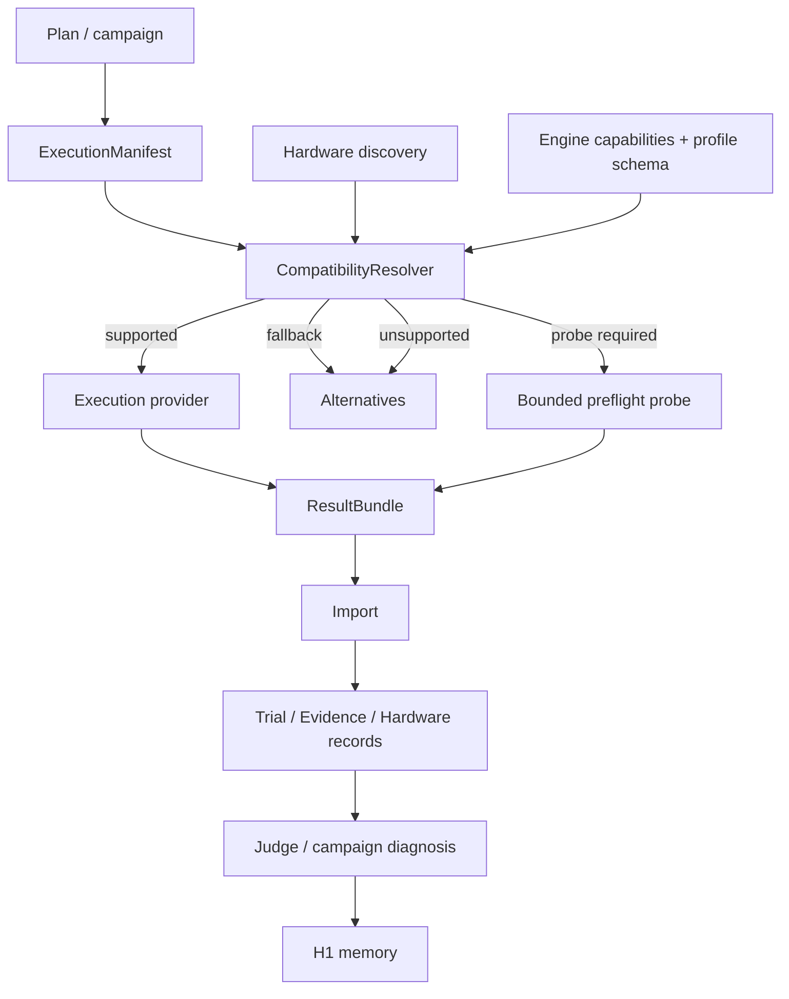

# InferStack portable experiment execution and remote GPU plan

Status: implementation plan, 9 November 2026. This document defines a cross-cutting execution track for the inference harness. It does not replace `INFERENCE_HARNESS_PLAN.md`, `CLOUD_SERVING_RESEARCH_PLAN.md`, or the H3/H4 campaign work.

## 1. Decision

InferStack should use **one experiment identity and one execution contract across local machines, notebooks, containers, cloud GPU providers and Kubernetes**.

Do not build a second remote-GPU configuration system. The repository already has the durable records and lifecycle machinery needed to describe most of an experiment:

- `ModelArtifact`
- `HardwareEnvironment`
- `Deployment`
- `WorkloadSpec`
- `Objective`
- `TechniqueV2`
- `ResourceAllocation`
- engine capability records
- engine profile schemas
- allocation ownership, quotas, leases and cleanup

The missing layer is a thin, immutable **ExecutionManifest** that binds those records into one reproducible run, resolves their pinned identity, and can be exported to an execution substrate.

The first milestone is named **E1 — Portable Experiment Execution**.

E1 is a cross-cutting track. It can proceed while H3/H4 continue, and it should reuse the existing H1 experiment memory, H2 diagnosis, H3 campaign/executor, infrastructure providers and verification gates.

## 2. Product boundary

InferStack owns inference execution and inference experimentation only.

- FactoryOS may supply request traces, workload distributions, inference SLOs and diagnosed inference issues.
- Model Foundry supplies immutable source model artifacts and owns training/adaptation.
- InferStack decides how to execute, benchmark, profile, pack, cache, schedule, quantize for serving, distribute and deploy those artifacts.
- A remote execution provider only supplies compute/lifecycle. It does not become a second optimization controller.

The portable execution track must not create a second planner, database, allocator or release system.

## 3. Core model



Execution substrates are interchangeable at the experiment boundary:

```text
attached host
Docker
Colab notebook
Kaggle notebook
RunPod Pod
Verda VM
Modal endpoint
Kubernetes GPU deployment
```

Each substrate has different lifecycle and cost semantics, but all must resolve the same experiment identity.

## 4. ExecutionManifest v1

The manifest is a **binding contract**, not a duplicate of the existing control-plane records.

Recommended implementation: `src/inferstack/execution/manifest.py`.

The v1 object should contain:

### 4.1 Record references

- model record ref
- deployment ref
- workload ref
- objective ref
- technique refs
- optional plan / implementation / campaign refs

### 4.2 Frozen resolved identity

At export time, resolve and freeze the identity needed to reproduce the run:

- source repository and commit
- model repository and immutable weights/config/tokenizer revisions
- engine name and exact version
- image digest where a container is involved
- plugin/backend versions and digests
- precision / dtype
- requested context length
- concurrency and output limits
- engine profile/options
- evaluator/measurement policy identity
- required workload fixture digest
- hardware requirements, not an invented observed environment
- runtime/time/GPU/provider-token/cost limits

### 4.3 Resource requirements

At minimum:

- GPU count
- minimum VRAM per GPU
- minimum compute capability when known
- required topology/parallel mode when relevant
- CPU/RAM minimums when relevant
- scratch/model-cache requirements
- network requirement
- maximum wall time
- maximum GPU seconds
- maximum provider spend

### 4.4 Quality and SLO gates

Examples:

- numerical equivalence policy
- required task/quality suite
- maximum quality regression
- TTFT / TPOT / E2E limits
- minimum output throughput/goodput
- error/stall limits
- memory ceiling

### 4.5 Canonical identity

Canonicalize JSON and compute a digest over the complete resolved manifest. The same manifest must produce the same digest. Any change to model revision, engine version, dtype, workload, hardware requirement, evaluator or technique creates a different experiment identity.

Do not hash secrets. Credentials are injected by the execution provider and never serialized into the manifest or ResultBundle.

## 5. Hardware discovery and compatibility

`infrastructure/inventory.py` already records GPU identity, memory, compute capability, topology, driver, CUDA and libraries. E1 should connect that observed `HardwareEnvironment` to a new resolver:

Recommended implementation: `src/inferstack/execution/compatibility.py`.

### 5.1 Resolver inputs

- ExecutionManifest
- observed HardwareEnvironment
- `engines/capabilities.py`
- `engines/profiles.py`
- model/deployment metadata
- TechniqueV2 compatibility requirements
- provider/runtime facts

### 5.2 Resolver output

Use four states:

- `supported`
- `supported_with_fallback`
- `unsupported`
- `probe_required`

Every result includes reasons and, where possible, explicit alternatives.

Example:

```json
{
  "status": "unsupported",
  "reasons": [
    "requested native FP8 compute requires a capability not established on this T4 profile"
  ],
  "alternatives": [
    "run the qualified FP16 T4 profile",
    "select an A100/H100-class target with a separately qualified engine path"
  ]
}
```

### 5.3 Rules that must fail closed

1. **Two GPUs are not one larger GPU.** Never add VRAM and declare a model feasible without a sharding/parallel plan that the engine supports.
2. **Capability flags are not activation evidence.** A configured backend or technique still needs a bounded runtime probe or qualified evidence.
3. **Model fit requires per-device reasoning.** Weight, KV, activation/workspace and parallel-layout requirements matter.
4. **Engine/model compatibility is versioned.** A model supported by vLLM version A is not automatically supported by version B or by SGLang.
5. **Precision is a serving treatment.** T4 FP16, A100 BF16 and an FP8 path are separate qualification profiles.
6. **Unknown is not supported.** If a required fact is not known, return `probe_required` or `unsupported`, never optimistic success.
7. **Proof reuse follows the existing H0/H1 applicability identity.** Different model/tokenizer/engine/image/dtype/hardware/workload/evaluator identity transfers only as a hypothesis unless the reuse contract permits proof.

## 6. T4 and multi-GPU policy

The first T4 path remains the existing qualified-intent FP16 serving profile.

For a T4:

- begin with FP16;
- do not assume native FP8 compute;
- treat any weight-only or alternative quantized path as a distinct technique that requires engine/model support and its own quality/performance evidence;
- use a separate T4 result identity from A100 BF16.

For two T4s:

```text
2 x 16 GB T4 != 1 x 32 GB GPU
```

The manifest must name a parallelism strategy such as tensor parallelism and a size. Compatibility must verify engine support, model divisibility/layout requirements and per-device fit. If the model fits only by unsupported sharding, the resolver returns an alternative before GPU work begins.

## 7. Notebook round trip

The first E1 execution target should reuse existing Colab/Kaggle capacity.

Recommended implementation:

- `src/inferstack/execution/notebooks.py`
- `src/inferstack/execution/results.py`
- CLI/API commands that reuse the existing control CLI rather than introducing a second command tree.

### 7.1 Export

A command conceptually equivalent to:

```bash
inferstack experiment export-notebook \
  --manifest <manifest-id-or-path> \
  --provider colab \
  --out experiment.ipynb
```

The generated notebook must be self-contained enough to:

1. display the immutable experiment identity;
2. discover the actual environment;
3. install/use the pinned engine environment;
4. run CompatibilityResolver/preflight;
5. stop before expensive work on an unsupported combination;
6. obtain/cache the pinned model artifact;
7. launch the selected engine;
8. run smoke/conformance checks;
9. run the requested benchmark/quality gates;
10. optionally run the requested profiler;
11. stop the engine and clean resources;
12. build a ResultBundle.

Do not silently weaken mandatory gates to obtain a pass.

### 7.2 ResultBundle v1

Recommended contents:

- manifest digest and resolved manifest
- observed HardwareEnvironment record
- environment/package lock/fingerprint
- executed commands/steps
- engine launch identity
- readiness/conformance results
- raw benchmark JSON/JSONL
- quality/numerical results
- profiler artifacts
- logs
- cost/runtime accounting available from the substrate
- terminal status and failure reason
- artifact checksums

Credentials and secret values are excluded.

### 7.3 Import

A command conceptually equivalent to:

```bash
inferstack experiment import-results result-bundle.zip
```

Import must:

- verify bundle checksums;
- verify the manifest digest;
- refuse identity mismatches;
- create/update the observed HardwareEnvironment;
- attach artifacts;
- create authoritative Trial/Evidence records only for checks actually run;
- mark missing mandatory evidence as missing/inconclusive, not passed;
- feed the result into the existing judge/campaign/memory path.

### 7.4 Colab and Kaggle

Start assisted:

- generate notebook locally;
- user runs it;
- user returns/downloads the bundle;
- InferStack imports it.

Later, automate Kaggle through its supported notebook/kernel API when the exact workflow is qualified. Do not make unattended Colab execution a prerequisite for E1.

Reuse the existing notebooks:

- `docs/notebooks/colab_a100_h0_qualification.ipynb`
- `docs/notebooks/colab_a100_engine_scorecard.ipynb`
- `docs/notebooks/kaggle_t4x2_serving_smoke.ipynb`

They are current fixtures to refactor toward generated manifests, not disposable prototypes.

## 8. Fair engine baseline policy

Native/vLLM/SGLang comparisons are valid only when the comparison identity is matched:

- same model and immutable model revision;
- same tokenizer revision;
- same workload fixture;
- same quality contract;
- same target GPU/hardware profile;
- intentional precision differences are declared treatments;
- engine versions and images are pinned;
- cache/warmup conditions are recorded;
- request counts and measurement policy are identical enough for the judge.

An unsupported engine/model intersection is not a performance loss. Record it as unsupported.

The current `docs/notebooks/colab_a100_engine_scorecard.ipynb` is the immediate fair-engine experiment and should be run before using engine-speed claims to steer later paid experiments.

## 9. Paid provider order

Pricing is a planning input only. Observed public prices on 9 November 2026:

| Role | Candidate | Observed compute price | Why |
|---|---|---:|---|
| first paid experiment adapter | RunPod A100 80 GB Pod | about $1.79/hour | direct pod/container/GPU lifecycle maps well to existing AllocationManager |
| second host-control provider | Verda A100 SXM4 40 GB VM | about $1.33/hour on-demand | price and VM control make it useful for low-level profiling |
| first autoscaling endpoint | Modal A100 40 GB | about $0.000583/sec (~$2.10/GPU-hour), plus CPU/RAM | useful after a configuration is verified; scale-to-zero endpoint role |

Sources:

- https://www.runpod.io/pricing
- https://verda.com/pricing
- https://modal.com/pricing

Prices are not compatibility or performance evidence. Provider storage/network/CPU and regional charges may differ. Before spending, stamp the actual price source/time into the allocation or require an operator-supplied maximum cost.

### 9.1 RunPod first

Add `RunpodProvider` behind the same allocation/provider contract already used by local/Docker/Kubernetes execution.

It should support:

- GPU type/count and region constraints;
- immutable container image;
- persistent/network volume when requested;
- environment injection without credential serialization;
- readiness;
- inspect/status;
- stop/terminate;
- hard terminate-after;
- cost accounting;
- orphan/reconciliation behavior;
- AllocationManager quotas and spend limits.

Do not bypass AllocationManager by calling the provider directly from campaign code.

### 9.2 Verda second

Implement only after RunPod proves the infrastructure-provider abstraction. Reuse the same manifest and allocation lifecycle. Prefer API/SDK/Terraform integration that can return stable instance identity and observable cost.

### 9.3 Modal endpoint

Modal's first role is deployment, not low-level kernel development.

Flow:

```text
verified ExecutionManifest/result
        -> immutable release
        -> Modal endpoint adapter
        -> readiness + conformance
        -> FactoryOS test traffic
        -> telemetry / rollout feedback
```

The endpoint must retain release/model/engine identity in InferStack.

## 10. Kubernetes role

Kubernetes remains part of the architecture, but it is an orchestrator, not a GPU source.

The repository already implements substantial `KubernetesProvider` behavior:

- Deployments and Services
- `nvidia.com/gpu` requests
- NetworkPolicy
- resource quota and limits
- read-only model-cache PVC
- cache verification init container
- deployment scaling
- verified cleanup

Local kind can validate lifecycle and recovery, not GPU performance.

Real GPU Kubernetes qualification requires a GPU node pool. The same ExecutionManifest must be replayable there, producing a ResultBundle with cluster/node/GPU identity. Production qualification comes after the cheaper notebook/paid single-node experiments establish a viable configuration.

## 11. Budget policy

Keep an operator hard ceiling (for example $85 during the initial program) but release spend by gates rather than allocating the whole amount up front.

Recommended progression:

- notebook capacity first;
- one bounded paid acceptance allocation;
- additional paid profiling only if the preceding result identifies a concrete blocker;
- deployment endpoint spend only after a verified candidate exists;
- GPU Kubernetes spend only when cluster behavior, routing, scaling or rollout is the question being tested.

Each campaign and provider allocation uses existing `Budget` / `ResourceAllocation` controls. Unknown cost must fail closed when a spend budget is required.

## 12. E1 work packages

### E1.0 — contract and fixtures

Build:

- `execution/manifest.py`
- `execution/results.py`
- canonical digest
- fixtures for A100 BF16, T4 FP16 and an intentionally incompatible case

Acceptance:

- deterministic digest;
- no secrets in serialization;
- changing model/engine/dtype/workload/hardware requirement/evaluator changes identity;
- existing records can round-trip into the manifest without duplicating mutable truth.

### E1.1 — CompatibilityResolver

Build:

- `execution/compatibility.py`
- rules backed by HardwareEnvironment, TechniqueV2, engine capabilities and profile validation
- alternative suggestions

Acceptance:

- T4 native-FP8-like unsupported case fails before launch;
- T4 FP16 supported fixture passes when engine/model profile declares support;
- 2xT4 cannot satisfy a single-32GB requirement without an explicit qualified sharding plan;
- unknown engine/model capability returns probe_required;
- fallback is explicit and changes experiment identity.

### E1.2 — notebook export/import

Build:

- generated Colab/Kaggle notebook from a manifest;
- ResultBundle;
- import command/API.

Acceptance:

- generated notebook runs the same ordered preflight/execute/package contract;
- a synthetic local notebook fixture exports/imports end to end in CI;
- tampered bundle is refused;
- manifest mismatch is refused;
- failed/missing gates remain failed/missing after import;
- imported hardware and artifacts are linked to the trial.

### E1.3 — fair A100 engine evidence

Use the already-prepared A100 scorecard notebook.

Acceptance:

- same pinned model/workload/hardware contract;
- Native, vLLM and SGLang run only where conformance passes;
- three-engine numbers are not reported when one lane is unsupported;
- results are imported into experiment memory.

This is primarily an execution task, not new architecture.

### E1.4 — RunPod provider

Build the first paid provider adapter behind the existing provider/allocation contract.

Acceptance:

- fake-provider unit contract;
- create/inspect/terminate/reconcile idempotency;
- exact GPU/image constraints;
- budget enforcement before launch;
- hard timeout/terminate;
- no credentials in durable spec;
- one bounded live provider smoke before declaring supported.

### E1.5 — verified autoscaling endpoint

Add Modal (or another operator-selected endpoint provider) only after a verified manifest exists.

Acceptance:

- exact release identity;
- readiness + conformance;
- request attribution;
- scale-to-zero/scale-up observation;
- cost identity;
- FactoryOS test traffic references the deployment/release;
- rollback/retirement works through existing release controls.

### E1.6 — GPU Kubernetes qualification

Replay a verified manifest on a real GPU Kubernetes node pool.

Acceptance:

- scheduler assigns requested GPU resources;
- exact node/GPU/image/model identity captured;
- model cache and readiness work;
- scale/replace/drain/stop release GPUs;
- rollout and rollback use real GPU data-plane evidence;
- no conclusion is transferred from kind/CPU-only lifecycle tests.

## 13. Interaction with H1-H5

E1 is not a replacement for the inference-harness roadmap.

- **H1 memory** supplies prior experiments and receives imported portable results.
- **H2 diagnosis** decides when the problem is inference and what evidence is missing.
- **H3 campaign/implementer** produces bounded candidate treatments that E1 can execute remotely.
- **H4 rollout/FactoryOS** consumes a verified portable result and release identity.
- **H5 harness optimization** may later measure whether provider selection/notebook automation improves optimization outcomes per fixed budget.

E1 should therefore begin now, while H3/H4 continue.

## 14. Immediate execution order

1. Run the existing A100 engine-scorecard notebook and preserve its result ZIP.
2. Implement E1.0 and E1.1 first: manifest + compatibility resolver. No cloud account is required.
3. Implement E1.2: generated notebook/result import, initially using assisted Colab/Kaggle.
4. Import the A100 scorecard result through the new path once E1.2 exists; do not rewrite historical raw evidence.
5. Add RunPod as the first paid provider only after the same manifest can execute/import through a notebook.
6. Deploy one verified configuration through Modal and connect one FactoryOS test workload.
7. Qualify real GPU Kubernetes only when cluster placement/scaling/rollout behavior is the question.

## 15. Non-goals for E1

Do not:

- replace AllocationManager;
- create another experiment database;
- give provider adapters optimization authority;
- auto-spend without a durable budget;
- infer support from GPU name alone;
- weaken verification gates for notebook convenience;
- compare different models/hardware and call it an engine benchmark;
- treat multiple GPU VRAM as a single memory pool;
- make Kubernetes mandatory for experiments;
- require a paid provider before the notebook round trip works.

## 16. Definition of E1 complete

E1 is complete when one pinned experiment can be exported from InferStack, preflighted against the actual hardware, executed on at least the assisted notebook path and one paid provider, imported into the existing trial/evidence/memory system, judged by the existing verifier, and replayed as a verified deployment candidate without changing its experiment identity.

A failure is also a valid E1 result if the system records the exact environment, reason and evidence and does not falsely promote the configuration.


## llama.cpp engine compatibility extension

llama.cpp is an **engine**, not an execution provider. It must therefore enter E1 through the same manifest/compatibility/runner boundary as Native, vLLM and SGLang. Provider choices such as local Docker, Colab/Kaggle, RunPod, Modal or Kubernetes remain orthogonal.

A future `LlamaCppAdapter` must pin the exact llama.cpp build/release and GGUF artifact identity. Compatibility must include model architecture, GGUF quantization, context, logical batch/ubatch, parallel slots, KV K/V types, GPU layer count, device list, split mode/tensor split, flash-attention mode and backend build (CUDA/Metal/HIP/etc.). Quantized GGUF evidence is a different treatment from BF16/F16 engine evidence unless the comparison contract explicitly says otherwise.

The implementation sequence is defined in [LLAMA_CPP_INTEGRATION_PLAN.md](LLAMA_CPP_INTEGRATION_PLAN.md). E1.3 paid-provider work does not wait for llama.cpp; engine-adapter work and provider-adapter work stay independent.
